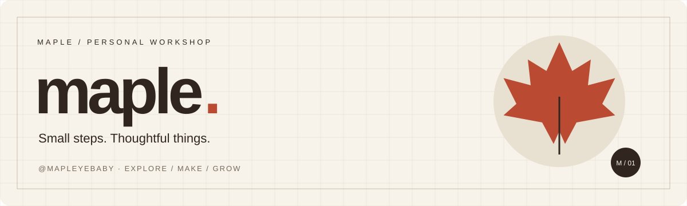
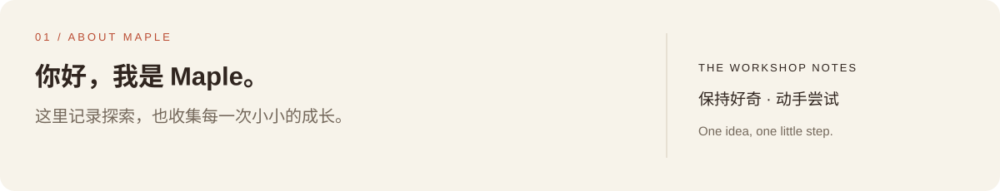
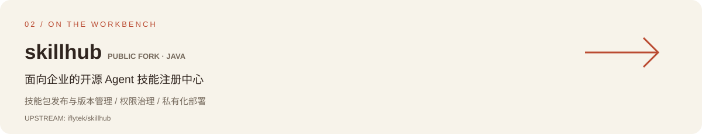

  
   
  <a href="https://github.com/mapleyebaby">GitHub</a> · <a href="https://github.com/mapleyebaby?tab=repositories">Repositories</a> · <a href="https://github.com/mapleyebaby?tab=stars">Star collection</a>

 

 

